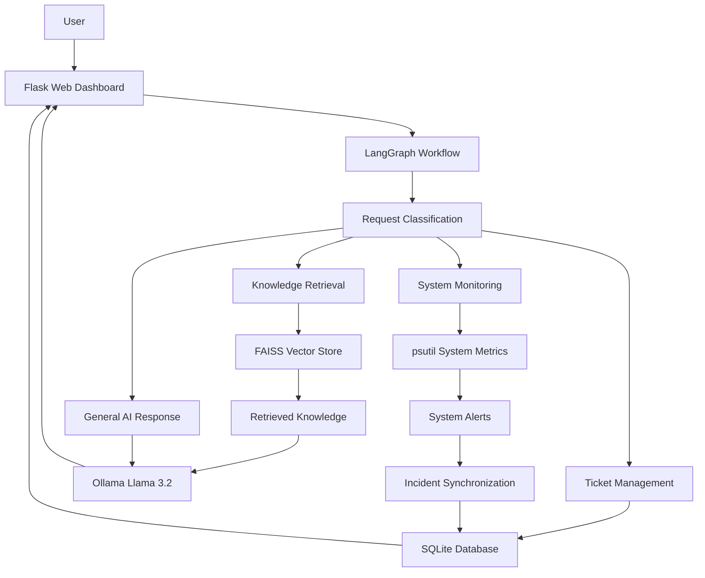
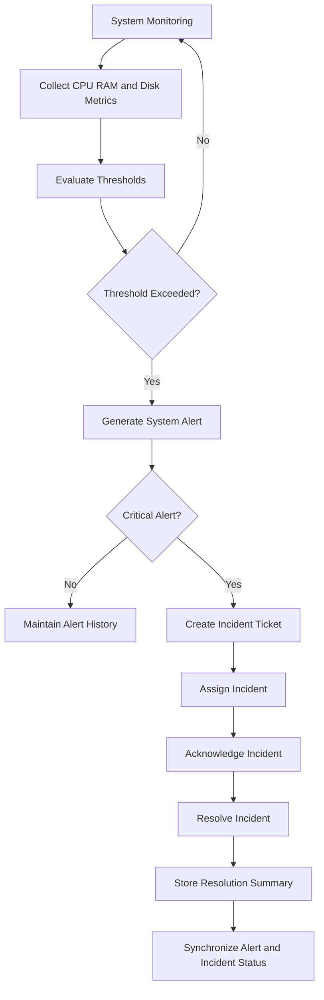

# AIOpsGenie – AI-Powered IT Operations & Incident Management Platform

<p align="center">
  <b>Intelligent IT Operations | AI Agents | Incident Management | System Monitoring</b>
</p>

AIOpsGenie is a locally hosted AI-powered IT Operations Assistant designed to support IT troubleshooting, knowledge retrieval, ticket management, system monitoring, alert generation, and incident lifecycle management through a unified web dashboard.

Built using Python, Flask, LangGraph, Ollama, FAISS, and SQLite, the platform combines AI-driven assistance with practical IT operations workflows.

The project demonstrates how Large Language Models (LLMs), Retrieval-Augmented Generation (RAG), workflow orchestration, and system monitoring can be integrated into an intelligent IT operations platform.

---

## 🚀 Key Features

### 1. AI-Powered IT Support Assistant

- Processes user requests through a LangGraph workflow.
- Classifies requests into support, knowledge, general, ticket, and system-monitoring categories.
- Uses a locally hosted Llama 3.2 model through Ollama.
- Provides contextual responses for IT support queries.
- Uses retrieved knowledge to support relevant troubleshooting responses.

### 2. Retrieval-Augmented Generation (RAG)

- Uses FAISS for vector-based knowledge retrieval.
- Uses Sentence Transformers for text embeddings.
- Retrieves relevant information from the local knowledge base.
- Generates responses using retrieved context.
- Provides fallback responses when relevant information is unavailable.

### 3. IT Ticket Management

- Creates support tickets through the AI assistant.
- Retrieves ticket information and status.
- Stores ticket records in SQLite.
- Supports ticket priorities and lifecycle tracking.

### 4. System Resource Monitoring

- Collects actual local system metrics using `psutil`.
- Monitors CPU utilization.
- Monitors RAM utilization.
- Monitors disk utilization.
- Calculates overall system health.

### 5. Intelligent System Alerts

- Generates alerts when resource utilization crosses configured thresholds.
- Supports warning and critical severity levels.
- Maintains alert history.
- Resolves alerts when monitored metrics return below warning thresholds.

### 6. Incident Management

- Automatically creates critical incident tickets from qualifying system alerts.
- Prevents duplicate alert-linked tickets.
- Supports incident assignment.
- Supports incident acknowledgment.
- Supports incident resolution with resolution summaries.
- Maintains incident notes.
- Synchronizes qualifying resolved alerts with linked incident tickets.

### 7. Flask Web Dashboard

The dashboard provides:

- System overview and ticket statistics.
- CPU, RAM, and disk monitoring.
- Resource usage history charts.
- Active and historical system alerts.
- Incident management queue.
- Ticket history.
- AI support assistant.
- Service monitoring overview.

**Monitoring limitation:** CPU, RAM, and disk metrics are collected from the local machine. VPN, email, database, firewall, and web service statuses are currently simulated demonstration data, not live external service health checks.

---

## 🛠️ Technology Stack

| Component | Technology |
|---|---|
| Programming Language | Python |
| Backend Framework | Flask |
| AI Model | Llama 3.2:3b |
| Local Model Runtime | Ollama |
| Workflow Orchestration | LangGraph |
| LLM Integration | LangChain |
| AI Architecture | Agent-based workflow |
| RAG Framework | Retrieval-Augmented Generation |
| Vector Store | FAISS |
| Embeddings | Sentence Transformers |
| Database | SQLite |
| System Monitoring | psutil |
| Frontend | HTML, CSS, JavaScript |
| Charts | Chart.js |
| Version Control | Git and GitHub |

---

## 🏗️ System Architecture



### Incident Lifecycle Workflow



---

## 📁 Project Structure

```text
AIOPS_GENIE/
│
├── app/
│   ├── __init__.py
│   ├── run.py
│   ├── routes.py
│   │
│   ├── agents/
│   │   ├── graph.py
│   │   └── state.py
│   │
│   ├── rag/
│   │   ├── loader.py
│   │   ├── embeddings.py
│   │   └── retriever.py
│   │
│   ├── tools/
│   │   ├── ticket_tool.py
│   │   └── system_tool.py
│   │
│   └── database/
│       └── db.py
│
├── data/
│   └── knowledge/
│       └── vpn_troubleshooting.txt
│
├── static/
│   ├── style.css
│   └── app.js
│
├── templates/
│   └── index.html
│
├── tests/
│   ├── run_evaluation.py
│   ├── test_evaluation.py
│   ├── test_graph.py
│   ├── test_incident_lifecycle.py
│   ├── test_rag.py
│   ├── test_system_api.py
│   ├── test_system_monitoring.py
│   └── test_tools.py
│
├── .gitignore
├── requirements.txt
└── README.md
```

Generated databases, logs, reports, and vector-store files are maintained locally and excluded from version control.

---

## ⚙️ Installation and Setup

### Prerequisites

- Python 3.10 or later.
- Git.
- Ollama.
- Sufficient RAM and disk space for the local language model and embedding model.

### 1. Clone the Repository

```bash
git clone https://github.com/Sankarkharada/AIOpsGenie.git

cd AIOpsGenie
```

### 2. Create a Virtual Environment

**Windows PowerShell:**

```powershell
python -m venv .venv

.\.venv\Scripts\Activate.ps1
```

**Linux/macOS:**

```bash
python3 -m venv .venv

source .venv/bin/activate
```

### 3. Install Dependencies

```bash
python -m pip install --upgrade pip

pip install -r requirements.txt
```

### 4. Install and Configure Ollama

Install Ollama and download the required model:

```bash
ollama pull llama3.2:3b
```

Ensure the Ollama service is running before starting the application.

### 5. Initialize the Database

```bash
python -m app.database.db
```

### 6. Start AIOpsGenie

```bash
python -m app.run
```

Open the dashboard in your browser:

```text
http://127.0.0.1:5000
```

---

## 🧪 Testing

AIOpsGenie includes individual test modules for its AI workflow, knowledge retrieval, system monitoring, APIs, and incident lifecycle.

Run the evaluation tests:

```bash
python -m tests.test_evaluation
```

Run system monitoring tests:

```bash
python -m tests.test_system_monitoring
```

Run system API tests:

```bash
python -m tests.test_system_api
```

Run incident lifecycle integration tests:

```bash
python -m tests.test_incident_lifecycle
```

Run RAG tests:

```bash
python -m tests.test_rag
```

Run tool tests:

```bash
python -m tests.test_tools
```

Run the evaluation script:

```bash
python -m tests.run_evaluation
```

Activate the project's virtual environment before running tests.

---

## 🔄 Incident Lifecycle

AIOpsGenie implements an alert-to-incident management workflow:

1. System metrics are collected.
2. Configured thresholds are evaluated.
3. Qualifying alerts are generated.
4. Critical alerts can generate linked incident tickets.
5. Duplicate alert-linked tickets are prevented.
6. Incidents can be assigned.
7. Incidents can be acknowledged.
8. Incidents can be resolved with resolution summaries.
9. Qualifying resolved alerts synchronize their status with linked incidents.

---

## 🔐 Current Project Scope and Limitations

AIOpsGenie is currently a locally hosted development and demonstration project.

- AI responses use a locally hosted Ollama model.
- Request routing combines explicit rule-based checks with LLM-based classification.
- Knowledge retrieval uses a local FAISS vector store.
- System resource metrics are collected from the machine running the application.
- Listed external service-status checks are simulated.
- Authentication and role-based access control are not yet implemented.
- The application is not currently configured as a production deployment.

---

## 🗺️ Future Enhancements

- Real external service health checks and integrations.
- Authentication and role-based access control.
- Additional monitoring integrations.
- More configurable alert thresholds.
- Enhanced incident reporting and analytics.
- Docker-based deployment.
- Production-ready logging and configuration.
- Expanded knowledge-base documents and evaluation datasets.

---

## 👨‍💻 Author

**Sankar Kharada**

B.Tech – Computer Science and Engineering (Cybersecurity), 2026

**GitHub:** [Sankarkharada](https://github.com/Sankarkharada)

**LinkedIn:** [Sankar Kharada](https://www.linkedin.com/in/sankar-kharada-83895b2a8/)

---

<p align="center">
  <b>Building Intelligent IT Operations Through AI and Automation.</b>
</p>
